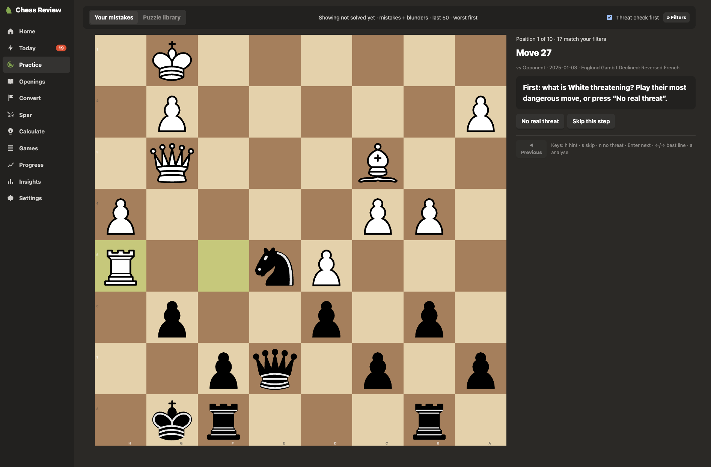

# Chess Review

**Turn your chess.com games into training: every move checked by Stockfish, every mistake explained in plain
English, and a daily workout built from your own games. Runs entirely on your machine.**

[](https://github.com/TomParkin1/chess-review/actions/workflows/ci.yml)
[](LICENSE)
[](pyproject.toml)

<!-- Screenshot placeholder: add docs/screenshot.png (the Game Report or Practice page) and uncomment:

-->

Lichess can analyse one game at a time. Chess Review imports all of your games at once (from chess.com's public
API or PGN files), analyses them in parallel, and then works on them with you.

## Features

- **Bulk import:** sync straight from chess.com, or import PGN files and folders. Duplicates are skipped.
- **Analysis:** Stockfish checks every position, several games at a time. Each game is analysed once and the
  results are kept.
- **Mistakes, explained:** inaccuracies, mistakes and blunders are judged by the drop in win chance, with
  thresholds that adapt to your rating. Each comes with a reason: a hanging piece, a missed fork, a
  checkmate you allowed, and so on.
- **Game Report:** accuracy, chess.com-style move marks, key moments, an eval graph and a time chart.
- **Practice:** replay your own mistakes as puzzles, with hints, a "threat check first" mode and an analysis
  board. Filter by opening, phase, colour, time control, kind of mistake or time trouble.
- **Today:** a 10, 20 or 30-minute daily plan. It mixes spaced-repetition reviews, new mistakes, "real game"
  positions, your top weakness and about 30% endgames.
- **Endgames:**
  - play won positions from your games out to the win against Stockfish
  - learn 15 essential endgames
  - with 7 pieces or fewer, the Lichess tablebase defends perfectly and tells you the move that threw the win
    away
- **More training:**
  - spar against Stockfish at about your rating, from your own positions
  - a calculation trainer
  - an opening repertoire explorer
  - about 19k Lichess puzzles with your own puzzle rating
- **Insights and Progress:** trends, accuracy by phase, clock use, openings and endgames; your top weaknesses,
  each with "Train this"; your recent games compared with the ones before.
- **Yours:** a SQLite file on your machine, automatic daily backups, and the web server only listens on
  `127.0.0.1`.

## Quickstart (about five minutes)

You need **Python 3.14+** and **[Stockfish](https://stockfishchess.org/)** (see [Installing Stockfish](#installing-stockfish)).

```sh
git clone https://github.com/TomParkin1/chess-review.git
cd chess-review
python3 -m venv .venv           # needs python3 --version >= 3.14; otherwise name it, e.g. python3.14
.venv/bin/pip install -e .

# Try it on the five anonymised sample games: no chess.com account needed
.venv/bin/chessreview import samples --as "Sample Player"
.venv/bin/chessreview analyse            # a minute or two
.venv/bin/chessreview mistakes --limit 5
.venv/bin/chessreview serve              # then open http://localhost:8000
```

On Windows, use `py -3.14 -m venv .venv` and run the commands from `.venv\Scripts\` (for example
`.venv\Scripts\chessreview serve`).

`--as` tells the app whose games these are. With your own games you don't need it: on first run, the web app
asks for your chess.com username and how much history to sync.

## Installing Stockfish

| OS | Command |
|---|---|
| macOS | `brew install stockfish` |
| Debian / Ubuntu | `sudo apt install stockfish` (installs to `/usr/games`, which is found automatically) |
| Fedora | `sudo dnf install stockfish` |
| Arch | `sudo pacman -S stockfish` |
| Windows | Download it from [stockfishchess.org/download](https://stockfishchess.org/download/), unzip it, and set `STOCKFISH_PATH` to the `.exe` |

The app looks for Stockfish in this order, and the first match wins:
1. `--stockfish PATH`
2. the `STOCKFISH_PATH` environment variable
3. `[engine] path` in `config.toml`
4. `stockfish` on your PATH
5. the usual Homebrew, `/usr/local` and Debian locations

If it can't find one, it says so and explains how to install it.

## Usage

### Your own games

- **From chess.com:** run `chessreview serve`, open http://localhost:8000 and enter your username. Or run
  `chessreview sync` once your username is set. Later syncs only fetch new months.
- **From PGN files:** run `chessreview import FILE_OR_FOLDER ...` (your username must be set, or pass `--as`).
  You can also upload files on the Home page.

New games are analysed automatically when the web app is running, or with `chessreview analyse`.

### Command line

```text
chessreview sync [--since all|3m|1m]   fetch new games from chess.com
chessreview import PATH... [--as NAME] import PGN files or folders
chessreview analyse [--limit N]        analyse new games with Stockfish
chessreview summary                    results by colour, time control and opening
chessreview mistakes [--limit N]       your worst moves, with explanations
chessreview serve [--port 8000]        the web app
chessreview reclassify                 re-judge stored evaluations after changing thresholds
chessreview puzzles                    download the Lichess puzzle library (~300 MB, streamed)
chessreview backup [--list]            make or list backups
chessreview restore NAME|FILE [--yes]  restore a backup (the current data is backed up first)
chessreview reset [--yes]              delete all games and analysis
chessreview simulate [--days 90]       simulate the daily plan's load on a copy of your data
```

Global options: `--config FILE` and `--stockfish PATH`.

## Configuration

Settings are read from `--config FILE`, else `$CHESSREVIEW_CONFIG`, else `config.toml` in the current folder.
Every setting has a default, so the file is optional. The repository's [`config.toml`](config.toml) lists them
all with comments.

| Setting | Default | What it does |
|---|---|---|
| `[engine] path` | (found automatically) | Stockfish executable |
| `[engine] time_per_position` / `max_depth` | 0.3 s / no cap | how long Stockfish looks at each position |
| `[engine] workers` | about ⅔ of your CPU cores | Stockfish processes run in parallel |
| `[classification] adaptive` | `true` | thresholds follow the mover's rating; Settings can switch to fixed ones |
| `[training] new_per_day` | 10 | new mistakes introduced into training each day |
| `[coach] budget_minutes` | 20 | default length of the daily plan |
| `[database] path` | `data/chess.db` | relative to the config file's folder (the current folder without one) |
| `[backup] daily` / `weekly` | 7 / 4 | backup copies kept |

Changing the thresholds never re-runs the engine. Stored evaluations are re-classified automatically.

## How it works

```
PGN / chess.com ─► import ─► Stockfish analysis ─► classification ─► explanations ─► training + web app
                  (dedupe)   (worker pool, cached)   (win-chance drop)  (rule-based)     (SQLite, Flask, ES modules)
```

| Path | Contents |
|---|---|
| `chessreview/pgn_import.py`, `chesscom.py` | importing and syncing |
| `chessreview/engine.py`, `live.py` | batch analysis (worker pool) and live engines for judging and sparring |
| `chessreview/classify.py`, `explain.py`, `report.py` | judgements, explanations, move marks and accuracy |
| `chessreview/srs.py`, `coach.py`, `session.py` | spaced repetition, the daily plan, new-games sessions |
| `chessreview/convert.py`, `tablebase.py`, `spar.py`, `calc.py`, `library.py`, `repertoire.py` | the training modes |
| `chessreview/insights.py`, `progress.py` | statistics and weaknesses |
| `chessreview/db.py`, `backup.py` | SQLite schema, migrations and backups |
| `chessreview/web/` | Flask app factory and one blueprint per area of the JSON API |
| `chessreview/static/`, `templates/` | the front end: plain ES modules, no build step |

[docs/architecture.md](docs/architecture.md) covers each part in more depth.

## Design decisions

<!-- Drafted from the code for the author to confirm and rewrite in their own words. Items marked "confirm" rest
on measurements or intentions that aren't visible in the code itself. -->

- **Store engine output once, derive everything else.**
  - Stockfish's evaluations are stored per position, from White's point of view.
  - Judgements, explanations, marks and accuracy are computed from them and can be rebuilt at any time. A
    fingerprint of the settings triggers this when thresholds or explanation rules change.
  - Analysis is the slow part (seconds per game); classification takes milliseconds.
- **Judge by win chance, not centipawns.**
  - Losing 300 centipawns matters when the game is level and barely matters when you are a queen up.
  - Moves are judged by the drop in win chance, using Lichess's curve and mate rules.
  - The thresholds widen for lower ratings, so a 900-rated player isn't held to a master's standard.
  - Rule kept throughout: nothing is tuned to one rating.
- **Many single-threaded engines.**
  - Analysis runs one single-threaded Stockfish per worker rather than a few multi-threaded ones.
  - <!-- confirm --> On the author's machine this analysed about twice as many positions per second at the same
    depth.
- **Rule-based explanations, checked against the engine.**
  - Explanations come from an ordered list of rules (first match wins), not a language model, so they are
    deterministic, testable and free to run.
  - Because the stored lines come from short searches, every material claim is checked against the evaluation
    before it is made.
  - <!-- confirm --> An audit against deeper analysis cut wrong explanations in the sample checked from 13/40
    to 0.
- **SQLite with numbered migrations.**
  - One file, no server, easy to back up.
  - Migrations are append-only functions tracked by `PRAGMA user_version`.
  - Backups use SQLite's backup API, and a copy is taken before anything destructive.
- **A small dependency footprint.**
  - Runtime dependencies are python-chess and Flask; everything else is the standard library (`sqlite3`,
    `tomllib`, `urllib`, `compression.zstd`).
  - The front end has no build step: ES modules, with chessground and chess.js from a CDN.
- **Stateless game play.** Playouts and sparring send the moves so far with each request. The server replays
  them, so there is no per-game state to lose or clean up.
- **Exact endgames where possible.** With 7 pieces or fewer, the Lichess tablebase gives perfect defence and
  exact verdicts. Answers are cached, so played endgames also work offline, and Stockfish takes over whenever
  the tablebase can't be reached.

## Development

```sh
.venv/bin/pip install -e ".[dev]"
.venv/bin/pytest                                  # ~45 s with Stockfish installed
CHESSREVIEW_FAKE_ENGINE=1 .venv/bin/pytest        # ~13 s, with a tiny fake engine instead
.venv/bin/ruff check . && .venv/bin/ruff format --check . && .venv/bin/mypy
```

- **Without Stockfish:** the tests run against `tests/fake_uci.py`, a deterministic one-move-lookahead UCI
  engine. No test touches the network or your database.
- **Opt-in suites with real Stockfish:**
  - `CHESSREVIEW_PLAYOUTS=1`: every endgame won or held by strong play
  - `CHESSREVIEW_CALIBRATION=1`: sparring strength measured in engine matches
- **CI:** runs lint, types and tests on Linux, macOS and Windows with Python 3.14 and 3.15. It also follows the
  quickstart above with real Stockfish.

Contributions are welcome: open an issue first for anything large. Use Conventional Commits, and make sure the
commands above pass before opening a pull request.

## Known limitations

- **One player.** The app is for one player's games on one machine. There are no user accounts, and the
  server only listens locally.
- **chess.com only for sync.** Lichess and other sites work through PGN export and import.
- **The browser needs internet access.** The board library (chessground) and chess.js load from a CDN.
- **Quick analysis.** Analysis is fast rather than deep: 0.3 s per position by default. Deep tactics can be
  misjudged; raise `time_per_position` for more accuracy.
- **Windows is only partly tested.** CI runs the tests there against the fake engine, not real Stockfish.
- **Python 3.14+.** The puzzle download uses `compression.zstd`, which is new in 3.14.

## Roadmap

- Re-check the positions that become training cards with a deeper search, so the occasional best move from the
  quick analysis that is wrong doesn't become a lesson.
- Serve the front-end libraries locally so the app works fully offline.
- Sync from the Lichess API as well as chess.com.
- A screenshot or short GIF in this README.

## Credits

- [Stockfish](https://stockfishchess.org/) for analysis.
- [python-chess](https://python-chess.readthedocs.io/), [chessground](https://github.com/lichess-org/chessground)
  and [chess.js](https://github.com/jhlywa/chess.js).
- **Opening names:** [lichess-org/chess-openings](https://github.com/lichess-org/chess-openings) (CC0).
- **Puzzles:** the [Lichess puzzle database](https://database.lichess.org/#puzzles) (CC0).
- **Endgame verdicts:** the [Lichess tablebase API](https://github.com/lichess-org/lila-tablebase) (Syzygy).
- **Mistake thresholds and the accuracy formula** follow Lichess.

## Licence

GPL-3.0-or-later, see [LICENSE](LICENSE). python-chess and chessground are GPL-3.0 too.
